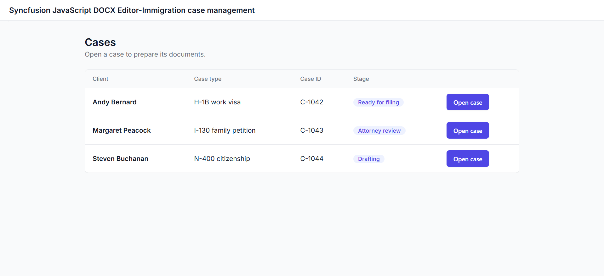
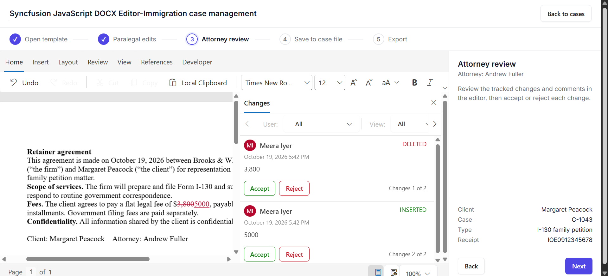

# Syncfusion® JavaScript DOCX Editor – Immigration Case Management

## Introduction

This sample demonstrates how the [Syncfusion® JavaScript DOCX Editor](https://www.syncfusion.com/document-editor/javascript) can be used to build an end-to-end immigration case document workflow. A law-firm-style application lets paralegals and attorneys pick an immigration case, generate a legal document from a template with case data merged into it, edit and review the document in the browser, save versioned copies to the case file, and export the final result as DOCX or PDF. The sample consists of a TypeScript webpack client and an ASP.NET Core Web API backend that performs the document processing (mail merge, DOCX save/load, and PDF conversion).

## Project Features

- Browse immigration cases and see each case's current workflow stage (template → paralegal edits → attorney review → save → export), with progress persisted on the server so a case resumes where it left off.
- Generate a document from a case template, automatically merging case data (client, form type, receipt number, employer, attorney, paralegal, date) into the template's merge fields.
- Edit and review the merged document in the full-featured DOCX Editor (ribbon and toolbar UI) directly in the browser.
- Save documents to a case file with version history: every save stores a new DOCX version that can be reopened from the case's document list.
- Export the finished document as a DOCX file or as a PDF for filing or sharing.

## Demo





## How to Run the Sample

This sample has two parts: a **client** (TypeScript + webpack, under `Client-Side/`) and a **backend** (ASP.NET Core Web API, under `Server-Side/`). Both must run — the document workflow (mail merge, save, export, PDF) is performed by the backend, and the client's Document Editor depends on it.

### 1. Start the backend

1. Ensure the .NET SDK targeting **.NET 10** is installed (the server project targets `net10.0`).
2. From the `Server-Side/src` directory, restore and run the project:

   ```bash
   dotnet restore
   dotnet build
   dotnet run
   ```

   By default the server listens on `http://localhost:62870` (configured in `Server-Side/src/appsettings.json`, `urls`). The startup profile is defined in `Server-Side/src/Properties/launchSettings.json`.

### 2. Configure the client to call the backend

Open `Client-Side/src/app/app.ts` and check the two API base URLs at the top of the file:

```ts
const API_BASE = 'http://localhost:62870/api/documenteditor';
const IMMIGRATION_API = 'http://localhost:62870/api/immigration';
```

If you changed the backend port or host, update these values to match (for example `http://localhost:<your-port>/api/...`) before starting the client. No other configuration is required; the backend enables cross-origin requests for the client.

### 3. Start the client

1. Ensure **Node.js** and **npm** are installed.
2. From the `Client-Side` directory, install dependencies:

   ```bash
   npm install
   ```

3. Start the client:

   ```bash
   npm run start
   ```

   Then open the local URL shown in the terminal output (webpack dev server).

> **Note:** The client calls `registerLicense('Your Syncfusion License')` in `Client-Side/src/app/app.ts`. Replace that placeholder with your own Syncfusion license key.

## APIs Used

| API / Endpoint | HTTP Method | Purpose |
|---|---|---|
| `/api/immigration/cases` | GET | Lists all immigration cases with their current stage. |
| `/api/immigration/templates` | GET | Lists the document templates available for a case. |
| `/api/immigration/cases/{caseId}/progress` | POST | Persists the workflow step so the case resumes and the home page shows the real stage. |
| `/api/immigration/cases/{caseId}/documents/{templateKey}/generate` | POST | Merges case data into the template's merge fields and returns the document as SFDT for the editor. |
| `/api/immigration/cases/{caseId}/documents/{templateKey}/open` | POST | Creates/opens a case document from the chosen template and returns SFDT. |
| `/api/immigration/cases/{caseId}/documents/{templateKey}/load` | GET | Loads the latest saved version of a case document into the editor. |
| `/api/immigration/cases/{caseId}/documents/{templateKey}/save` | POST | Saves the editor's document as a new DOCX version in the case file. |
| `/api/immigration/cases/{caseId}/documents` | GET | Lists all documents (with version history) saved to a case. |
| `/api/documenteditor/ExportPdf` | POST | Converts the current editor document to PDF and returns it for download. |

The Document Editor component in the client is configured with a `serviceUrl` pointing at the backend's document-processing service (`/api/documenteditor`), which handles the editor's built-in server-side operations (such as spell-check and system-defined actions). The `/api/immigration/*` routes above are custom sample APIs implementing the case-management workflow.

## Resources

- **Product page:** [Syncfusion® JavaScript DOCX Editor](https://www.syncfusion.com/document-editor/javascript)
- **Documentation:** [Syncfusion® JavaScript DOCX Editor - Documentation](https://ej2.syncfusion.com/documentation/document-editor/getting-started/)
- **Online demo:** [Syncfusion® JavaScript DOCX Editor - Online demo](https://ej2.syncfusion.com/demos/#/fluent2/material3/document-editor/default.html)

## Support and feedback

For any other queries, reach our [Syncfusion® support team](https://support.syncfusion.com/) or post the queries through the [community forums](https://www.syncfusion.com/forums).

Request new feature through the [Syncfusion® feedback portal](https://www.syncfusion.com/feedback).

## License

This is a commercial product and requires a paid license for possession or use. Syncfusion's licensed software, including this component, is subject to the terms and conditions of [Syncfusion's EULA](https://www.syncfusion.com/license). You can [purchase a license here](https://www.syncfusion.com/sales/products) or start a [free 30-day trial here](https://www.syncfusion.com/account/manage-trials/get-trial).

The sample source code itself is licensed under the terms in `Client-Side/license` (see the repository files for details).
